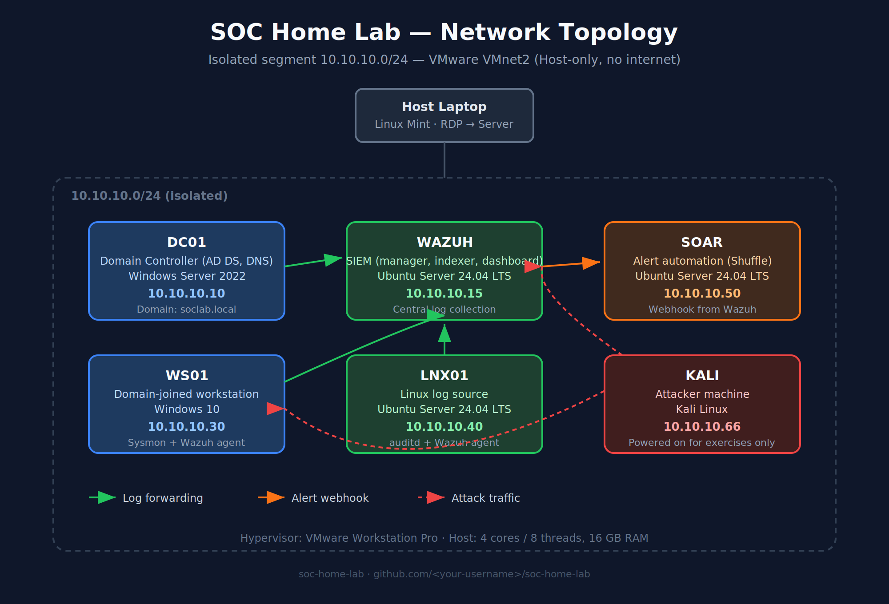

# SOC Home Lab

A self-hosted Security Operations Center lab built to practice detection engineering, incident response and SOAR automation — from IT support background, working toward a SOC Analyst / Cybersecurity role.

## Network Topology

## Lab Topology

| Hostname | Role | OS | IP Address | Notes |
|----------|------|-----|-----------|-------|
| DC01 | Domain Controller (AD DS, DNS) | Windows Server 2022 | 10.10.10.10 | Domain: soclab.local |
| WAZUH | SIEM (manager, indexer, dashboard) | Ubuntu Server 24.04 LTS | 10.10.10.15 | Central log collection |
| WS01 | Domain-joined workstation | Windows 10 | 10.10.10.30 | Sysmon + Wazuh agent |
| LNX01 | Linux log source | Ubuntu Server 24.04 LTS | 10.10.10.40 | auditd + Wazuh agent |
| SOAR | Alert automation (Shuffle) | Ubuntu Server 24.04 LTS | 10.10.10.50 | Webhook from Wazuh |
| KALI | Attacker machine | Kali Linux | 10.10.10.66 | Powered on for exercises only |

**Network:** Isolated segment `10.10.10.0/24` (VMware VMnet2, host-only, no internet access by design).
**Hypervisor:** VMware Workstation Pro, running on a dedicated server (4 cores / 8 threads, 16 GB RAM), accessed remotely via RDP from a Linux Mint laptop.

## Project Goals

- Build a realistic small AD + SIEM environment from scratch
- Simulate real attack techniques mapped to MITRE ATT&CK
- Write detection rules (Wazuh / Sigma) for each technique
- Automate alert enrichment and response with a SOAR workflow (Shuffle)
- Document each exercise as an incident report, the way a SOC analyst would

## Repository Structure
