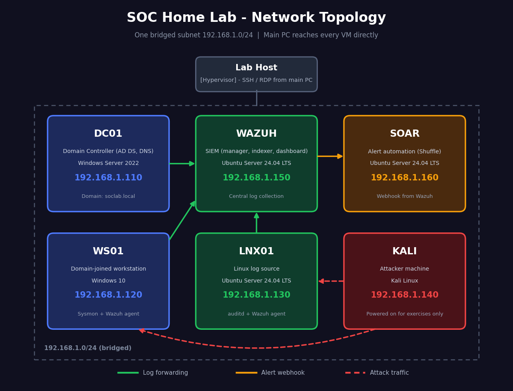

# SOC Home Lab

A self-hosted Security Operations Center lab built to practice detection engineering, incident response and SOAR automation — from an IT support background, working toward a SOC Analyst / Cybersecurity role.

## Network Topology



## Lab Topology

| Hostname | Role | OS | IP Address | Notes |
|---|---|---|---|---|
| DC01 | Domain Controller (AD DS, DNS) | Windows Server 2022 | 192.168.1.110 | Domain: soclab.local |
| WAZUH | SIEM (manager, indexer, dashboard) | Ubuntu Server 24.04 LTS | 192.168.1.150 | Central log collection |
| WS01 | Domain-joined workstation | Windows 11 | 192.168.1.120 | Sysmon + Wazuh agent |
| LNX01 | Linux log source | Ubuntu Server 24.04 LTS | 192.168.1.130 | auditd + Wazuh agent |
| SOAR | Alert automation (Shuffle) | Ubuntu Server 24.04 LTS | 192.168.1.160 | Webhook from Wazuh |
| KALI | Attacker machine | Kali Linux | 192.168.1.140 | Powered on for exercises only |

## Project Goals

- Build a realistic small AD + SIEM environment from scratch
- Simulate real attack techniques mapped to MITRE ATT&CK
- Write detection rules (Wazuh / Sigma) for each technique
- Automate alert enrichment and response with a SOAR workflow (Shuffle)
- Document each exercise as an incident report, the way a SOC analyst would

## Repository Structure

```
soc-home-lab/
├── README.md
├── images/              # topology diagram
├── docs/                # setup guides + screenshots
├── configs/             # Sysmon, Wazuh, auditd configs
├── detection-rules/     # Wazuh and Sigma rules
├── playbooks/           # SOAR (Shuffle) workflows
└── incident-reports/    # one report per exercise
```
